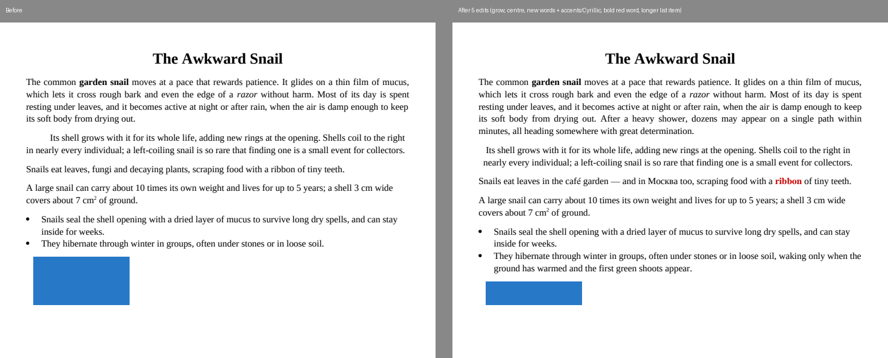

# SimplePDF Editor

A PDF editor for Windows by [Awkward Snail](https://awkwardsnail.com.au): add and rearrange pages, edit and add text and pictures, draw shapes, highlight and comment, and save a copy as RTF for a word processor. It works offline, collects no data and never goes online.

## Layout

- `src/PdfEditor.Core` – the editing engine (no UI), including paragraph reflow (`Reflow/`) and RTF import (`Rtf/`). Built on [PDFium](https://pdfium.googlesource.com/pdfium/) (BSD/Apache licensed) through its native packages for Windows, Linux and macOS.
- `src/PdfEditor.App` – the Windows desktop editor (WPF). The whole editor lives in `PdfEditorControl`, so it can be dropped into another WPF window; `MainWindow` is a thin shell around it.
- `tests/PdfEditor.Core.Tests` – xUnit tests for the engine.

## Editing paragraphs with reflow

A PDF has no paragraphs, only characters placed at positions. `PdfEditor.Core` works the paragraphs out from where the characters sit, and can rewrite one so that its words wrap again, the way a word processor would.



```csharp
using var doc = PdfDocument.Open("in.pdf");

var paragraph = doc.FindParagraphAt(0, 120, 300);       // or doc.GetParagraphs(0)
Console.WriteLine($"{paragraph.Alignment}, {paragraph.LineCount} lines: {paragraph.Text}");

doc.ReplaceParagraphText(0, paragraph.Index, "New wording for the whole paragraph...");
doc.ReplaceInParagraph(0, paragraph.Index, start: 10, length: 5, "words");
doc.FormatParagraphText(0, paragraph.Index, 0, 4, new TextFormat { Bold = true, Color = new PdfColor(200, 0, 0) });
doc.SetParagraphAlignment(0, paragraph.Index, TextAlignment.Justify);
doc.ReplaceText("colour", "color");                     // whole document, every changed paragraph re-flows
doc.Save("out.pdf");
```

Paragraph indices are valid until the page changes, so read the paragraphs again after each edit.

**What is kept**

- Position, width, alignment (left, centre, right, justified), first-line indent, list-item hanging indent and line spacing.
- Formatting of the text that survives an edit: bold or italic words, colours, sizes, superscripts. New text takes the formatting around it.
- The original embedded fonts. Embedded fonts usually hold only the letters the document already uses; any other letter is drawn in a look-alike font (a standard PDF font of the same family, or an installed font for accents and other scripts), and the result says so.
- Everything else on the page. When the paragraph grows or shrinks, content below it in the same column (text, images, highlights and comments) moves with it; the other columns and the footer area stay put. On a page laid out in boxes or tables (a box or panel holds the paragraph and room below it, or a rule or shading reaches past the column over text that would not move with it), moving part of the page would tear the layout apart: there the paragraph changes in place, nothing else moves, and the result says so (`LeftInPlace`).
- The letter spacing the paragraph was set with. Publishers often set type a little tighter than its font does; the spacing is measured, used when wrapping, and written into the new text, so a rewritten paragraph is no looser than the text around it and does not grow a line for that reason. A paragraph that keeps its number of lines puts each line back exactly where it was.

**How paragraphs are found**

Lines are grouped into a paragraph when they share a text size and the page's usual line spacing, line up on the left, centre or right, and when each line was too full to take the next line's first word (a line with room to spare ended on purpose). Hyphenated words split across lines are joined back together.

**Limits**

- Detection is a judgement made from positions. Unusual layouts (tables, text in shapes, multi-column text drawn out of order) may be grouped differently from how they look.
- A forced line break inside a paragraph is drawn, but the PDF does not record it, so reading the page back gives one paragraph of two lines.
- Re-written lines keep the paragraph's overall letter spacing, but not the fine kerning between particular pairs of letters.
- Text that runs past the bottom of the page is reported (`RunsOffPage`), not moved to the next page.
- Right-to-left scripts, vertical text and text inside form XObjects are not re-flowed.

**Editing a page's instructions directly.** A page is a list of drawing instructions. PDFium reads them into a list of items and can write that list back only in part: it leaves out or flattens whatever it does not model (tiled patterns, gradients, soft masks, pictures written into the instructions, Type 3 text, CMYK and spot colours, letter spacing). So where it can, the editor does not have PDFium write the page at all. It reads the instructions itself (`Content/PageInstructions`), works out which of them draw the item being changed, and rewrites only those: an item is moved by boxing its own instructions in a shift, and removed by taking them out. Everything else on the page stays byte for byte as it was. This is used for moving, turning and deleting text, shapes, pictures, groups and gradients. Text needs one more step: pieces of text in a block share a writing position, each starting where the one before ended, so after a piece is moved or removed the position is set back to exactly where the original instruction would have left it (PDFium, which has measured the letters, is asked where the next piece starts). A move up or down a layer is done the same way: the item's instructions are taken out where they are and written again just past the item it is to pass, in a box of their own in which every setting the item was drawn with (coordinate space, clip, colours, line, font and text settings) is given afresh; the reader keeps those settings, as written, for every item. Where the new place is under a clip the item would be cut by, or see-through settings it never had, the item is put just outside that saved-state section instead. An item moved to where the clip it is drawn under would cut it is drawn just outside that section with its clip moved along. A shape's filling and line are changed by keeping its path as written and setting the colours and width just for it. A piece of text is recoloured by setting the colour before it and putting the old one back after it. Changes that put new text in place of old (rewriting a paragraph, find and replace, a change of font, size, bold or italic) are made in two steps: PDFium adds the new text, which it does without disturbing what is there; then one pass over the instructions removes the old text, shifts what lies below, and puts the new text where the old stood in the drawing and reading order. Text that itself clips, see-through colours and password-protected files still go the older way described next, as does anything the reader cannot follow on a given page.

**Keeping the rest of the page intact.** When an existing object changes, PDFium rewrites the page's original content and drops word and character spacing on the way, which would shift justified text elsewhere on the page. Before that happens, any text that depends on those settings is redrawn with each character pinned where it was. This also protects the editor's move, resize, delete and edit-text operations.

## Importing RTF

RTF documents (from Word, WordPad, LibreOffice and others) are laid out as PDF pages. The pages are ordinary editable PDF content, so imported paragraphs can be edited with reflow straight away.

```csharp
using var doc = PdfDocument.FromRtf(File.ReadAllBytes("notes.rtf"), out var result);
foreach (var warning in result.Warnings) Console.WriteLine(warning);   // what could not be brought across
doc.Save("notes.pdf");

existing.ImportRtf("appendix.rtf", index: 3);                         // or insert into a PDF that is open
```

**Brought across:** page size and margins; fonts, sizes, bold, italic, underline, strikethrough, colours, highlighting, superscript and subscript; alignment (including justified), indents, space before and after, line spacing, tab stops; bulleted and numbered lists; tables with borders; PNG and JPEG pictures; page and section breaks; Unicode and code-page text (including Cyrillic, Greek and other scripts).

**Left out (and reported in `Warnings`):** headers and footers, WMF/EMF pictures, tables inside tables (flattened). Footnotes, comments, fields' codes and drawing objects are skipped silently.

**Fonts.** By default the standard PDF fonts are used (Times, Helvetica, Courier, chosen to match each RTF font's family): small files that look the same everywhere. Text those fonts cannot show (for example Cyrillic or Greek) is drawn in a matching installed font, which is embedded. `new RtfImportOptions { EmbedFonts = true }` embeds the installed fonts the RTF names (Calibri, Georgia, ...) for a closer look; PDFium embeds whole font files, so this makes much larger PDFs.

Line breaks are worked out by this library, so they can differ slightly from the word processor's.

## Saving as RTF

`ExportRtf` writes the document for a word processor: its paragraphs with their fonts, sizes, bold, italic, colour and alignment, its pictures where they come in the text, and a new page (or a new section, where the page size changes) for each page. In the editor it is a file type in **Save As**; the PDF being edited stays as it is.

```csharp
byte[] rtf = doc.ExportRtf(out var result);   // result says how much was written and what was left out
File.WriteAllBytes("notes.rtf", rtf);
```

A PDF fixes where everything stands and RTF lets text run on, so exact positions, columns, drawn shapes, comments and highlights are not kept. Pictures are stored without loss (PNG), so a file with many pictures is large.

## Running the editor (Windows)

Needs the .NET 8 SDK (or Visual Studio 2022 with the ".NET desktop development" workload).

```
dotnet run --project src/PdfEditor.App
```

or open `PdfEditor.sln` in Visual Studio and run `PdfEditor.App`. A PDF path on the command line, or a PDF dropped on the window, opens that file.

### Using it

| Tool | What it does |
|---|---|
| **Select** | Click an item to select it, drag to move text or images, drag an image's corner handle to resize it, Delete to remove. Double-click a paragraph to rewrite it: when you finish, it re-flows. Double-click a comment to change it. With text selected, the Paragraph buttons set its alignment. |
| **Text** | Click where new text should start and type. Enter adds a line; Ctrl+Enter or clicking elsewhere finishes; Esc cancels. Font, size, bold, italic and colour come from the toolbar. |
| **Highlight** | Drag across text to highlight it in the chosen colour. Dragging over an empty area highlights that area. |
| **Comment** | Click where the comment should go and type it. Comments and highlights are listed on the right. |
| **Image** | Pick an image file; it is placed in the middle of the page, ready to drag and resize. |

A click on a drawing goes by what is actually drawn at that point, the topmost first: a shape's filling or its line, not the box around it. Empty space inside a figure, or inside a box with no filling, picks the smallest drawing around the point. Shapes that touch are one figure, selected, moved and deleted together; right-click a figure and choose **Ungroup** to pick, fill or move each of its shapes on its own, or drag a box round several shapes and choose **Group** to join them. A shape just drawn starts on its own. Grouping is remembered while the document is open (a PDF keeps no groups). A click on something inside a stored group (a header or logo block stored as one unit) takes the group apart so its parts can be selected; where the group's text cannot safely stay text, it becomes shapes that look the same.

The view scrolls on from page to page: the page being worked on has the page before it above and the page after it below, and the page that reaches the middle of the view becomes the one being worked on. The zoom buttons sit on a slim bar right above the page. The page list on the left can be resized by dragging its edge, and pages reordered by dragging them: a line shows where the page will land. The comments panel on the right can be hidden with the button on its edge.

**Drawing**: the Line, Arrow, Box, Circle and Spline tools draw vector shapes, sharp at any size, in the chosen line colour and thickness. Drag for a line, arrow, box or circle; Shift keeps a line level, upright or at 45 degrees, a box square and a circle round. For a spline, click point after point and the curve passes smoothly through each; double-click or Enter finishes, Esc cancels. Fill sets whether new boxes, circles and splines are filled or see-through. Right-click any drawing for **Filling...** (a colour, or none for see-through; lines and arrows take no filling), **Line...** (colour and thickness) or Delete. Drawn shapes are selected, moved and deleted with the Select tool like any other item.

**Blocks of text**: with Select, drag from empty paper to draw a box; every piece of text it touches is selected as one block, which moves and deletes together. A press inside the block moves it. **Right-click text** (one piece or a block) for **Font and colour...** (sans, serif or mono; size; bold; italic; colour: only what is changed in the dialog is applied), **Rotate right** and **Rotate left** (a quarter turn about the middle of the block), the layer moves and Delete. A change of font, bold or italic sets the text in a standard font, since a document's own fonts rarely hold the letters for another weight; a change of colour alone keeps the font. Turned text can still be moved, turned back, deleted, and rewritten a piece at a time (the editing box is turned the same way).

**Layers**: the right-click menu of a drawing, a picture or a piece of text has **Move one layer up** and **Move one layer down**. The item passes the nearest item it overlaps, so each step changes what is seen; when nothing overlaps it that way, it is at the front or back already. The move is made in the page's own instructions (see "Editing a page's instructions directly"), so it works for every kind of item, groups, gradients and clipped items included, and changes nothing else on the page. Only where that cannot be done is the older way used: PDFium keeps existing content in the order it was first written and only honours the place of new objects, so the item is replaced by a fresh copy of itself in its new place, which groups, gradients and items clipped to a shape do not allow.

**Comments and highlights** can be dragged like anything else. Right-click one to change its comment, move it one layer up or down, or delete it. They always lie over the page itself; the layer moves order them among themselves.

**Watermark** writes a word or two (DRAFT, COPY, a name) large and see-through across the middle of this page or every page, corner to corner or level, in a chosen colour and strength. It is ordinary text: click it with Select and press Delete to take it off. Because it lies across the page, a click picks it only where nothing else is.

**Images**: right-click an image to edit it in Paint (save there, confirm in the editor, and the edited picture takes its place), rotate it left or right, resize it to a size in millimetres, replace it with another picture, or delete it.

**Page break**: select an item and choose Page break; it and everything below it move to a new page inserted after the current one, starting at the top margin. Footers stay on their page, and comments, highlights and web links go with their text. With nothing selected, Page break shows a line that follows the mouse and settles in the gaps between rows of content; a click breaks the page there (Esc cancels). A very long page, such as a web page saved as one sheet, is cut like paper instead: it ends at the line and the rest goes onto a new page just tall enough for it. Content is moved, never copied, so the file does not grow.

**Print as tiles** saves the current page as a separate PDF spread over several sheets of ordinary paper (an A2 poster on A4 sheets, say), to print and join. The dialog shows the page small with the sheets drawn over it: each sheet is tinted, its printed area a darker shade. In **Auto**, choose the paper, real size or a number of sheets to fit or a scale, the overlap between sheets and the blank edge the printer cannot reach, and the sheets are laid out in a grid. In **Manual**, **+** adds a sheet to drag into place over the page (the arrow keys move it 1 mm, 10 mm with Shift; Delete removes it). Each sheet has a row in a table where its paper, which way up it is and its blank edge are chosen, so sheets of different papers can be mixed; a new sheet starts like the selected one. The sheets are saved in the order they were added. Where sheets lie over each other the colour says what meets: green for two blank edges, orange for a blank edge over a printed area, red for two printed areas. Cut marks and sheet numbers go in the margins. The page is stored once in that file and each sheet shows its own part of it, so the file stays small. The document being edited is not changed.

**Fonts that share a name.** Some PDFs (often made on macOS) hold several different embedded fonts with one name, told apart only by a six-letter prefix. PDFium cannot tell these apart when it rewrites a page, so on opening such fonts are given names of their own (`Helvetica-2`). The page looks the same and the text stays editable; the new names are kept when the file is saved.

**Text stored letter by letter, and Type 3 fonts.** Some programs (Chrome's "Save as PDF" among them) store text a letter at a time, often in Type 3 fonts: fonts whose letters are small drawings, with no name of their own. A click then picks up one letter, and PDFium, which can show Type 3 text, leaves it out when it writes a page again. When such a file is opened the editor offers to convert it: each stretch of a line in one look becomes one piece of ordinary text in the same place and size. Type 3 text is set in the standard font whose letters are closest in width (sans, serif or mono, regular or bold), fitted to the width it had, so the layout holds though the letters look a little different; text in an ordinary font keeps its font and is only joined up. If the offer is declined, Type 3 text on a page that is changed is replaced by small pictures of itself (288 pixels per inch) so that it does not vanish; it then looks the same but is no longer text.

**File size.** PDFium writes every object of a document out in plain text. A document with many small objects (a tagged one has thousands) then comes out much larger than it went in, because the program that made it had packed those objects into compressed object streams. After saving, the editor packs them again the same way (PDF 1.5 object streams and a cross-reference stream) and leaves out objects nothing refers to any more, so a file does not grow just for being saved. Password-protected files are saved as PDFium writes them.

**Gradients.** PDFium can show a shaded fill (a gradient) but leaves it out when it rewrites a page, so before a page is rewritten each gradient on it is replaced by a picture of itself (144 pixels per inch) in the same place. Gradients inside a group are untouched unless the group is taken apart. Some programs write a see-through effect as a "gradient" that is one flat colour all over, which shows as a solid box (black boxes over links in web pages saved from Safari, for example). Right-click such a box to delete it, or all the boxes like it on the page.

**Page list**: right-click a page in the list on the left to rotate it right or left, resize it or delete it. **Resize page** asks for the new size and whether what is on the page is made larger or smaller to fit (it keeps its shape and sits in the middle); without that, everything stays the size it is and keeps its place from the top-left corner. Scaling is written in front of the page's content, so nothing on the page is rewritten.

**Add page** asks for the new page's size: the same as the current page, A0 to A6, Letter, Legal or any size in millimetres, portrait or landscape. The size can be kept for every new page; hold Shift while choosing Add page to be asked again. The kept size is stored in a small file on this computer only.

**Find & replace** (Ctrl+H) replaces text throughout the document and re-flows each paragraph it changes.

**Open** also accepts RTF files: the document is laid out as a new PDF (named after the RTF file, not saved until you save it). **Insert file** adds the pages of a PDF or an RTF document after the current page. Anything that could not be imported is listed after the import.

Page buttons add a blank page, insert another PDF's pages, delete, rotate and reorder the current page. Deleting a page also removes the links on other pages that led to it, and takes the bookmarks that led to it out of the saved file; a bookmark that still has others beneath it stays as a heading. Undo/redo (Ctrl+Z / Ctrl+Y) covers every change. Ctrl+mouse wheel zooms.

## What the engine does

- **Pages** – add blank pages, delete, reorder, rotate, import pages from another PDF.
- **Text** – add text (standard fonts, or an embedded TrueType font when characters need it), list the text runs on a page, edit a run in place, move or remove it.
- **Images** – add JPEG, PNG, BMP, GIF or TGA images, list, move and remove them.
- **Comments and highlights** – sticky-note comments, highlight/underline/strikeout/squiggly markup, search and "highlight every match".
- **Rendering** – render any page to BGRA pixels for display.

All coordinates are in points (1/72 inch) from the top-left of the page as displayed.

```csharp
using PdfEditor.Core;

using var doc = PdfDocument.Open("in.pdf");
doc.AddPage();                                        // blank A4 page at the end
doc.AddText(0, 72, 72, "Hello", new TextStyle { Size = 18, Bold = true });
doc.AddImage(0, File.ReadAllBytes("logo.png"), 72, 120, width: 150);
doc.HighlightText(0, "important");
doc.AddComment(0, 400, 72, "Please review", author: "Me");

var run = doc.FindTextRunAt(0, 100, 300);             // click-to-edit
if (run is not null) doc.EditText(0, run.ObjectIndex, "New wording");

doc.Save("out.pdf");
```

### Limits of text editing

A PDF stores text as separately positioned runs, not paragraphs. Editing a run changes its wording in place; the surrounding text does not reflow. When the run's embedded font lacks a needed character, a similar font is substituted and `EditText` reports it.

## Tests

```
dotnet test tests/PdfEditor.Core.Tests
```

The engine tests run on Windows, Linux and macOS. The app itself only runs on Windows.

The reflow and RTF tests read files in `tests/PdfEditor.Core.Tests/Fixtures`, made by `make_fixtures.py` there (python-docx, reportlab and LibreOffice): a Word-style document exported by LibreOffice with subset-embedded fonts, a two-column document justified with word spacing, and a Word document saved as RTF by LibreOffice.

`ConformanceTests` saves the result of every kind of edit and has [qpdf](https://qpdf.sourceforge.io/) check each file's structure against the PDF specification (ISO 32000-1). Install qpdf with `winget install QPDF.QPDF`; without it those tests pass with a note saying nothing was checked.

PDFium is not thread-safe, even across separate documents: use the library from one thread at a time.

## Licence

MIT (see `LICENSE`). Forks are welcome but may not use the Awkward Snail name.

The app builds on work by others, each under its own licence:

- [PDFium](https://pdfium.googlesource.com/pdfium/) (BSD 3-Clause and Apache 2.0), through the `bblanchon.PDFium` packages.
- [StbImageSharp](https://github.com/StbSharp/StbImageSharp) (public domain) for reading image files.
- Atkinson Hyperlegible Next (SIL Open Font Licence 1.1, `src/PdfEditor.App/Fonts/OFL.txt`) for the app's own text.
- The .NET runtime (MIT), which the Store package carries so that nothing else needs installing.

`src/PdfEditor.App/THIRD-PARTY-NOTICES.txt` holds these notices and ships with the app.
